# Machine Learning Models and Evaluation

[English](README.md) | **한국어**

회귀, 분류, 군집화 및 순차 데이터 분석을 다루는 **머신러닝 모델 구현 및 성능 평가 프로젝트**입니다.

전통적인 머신러닝 알고리즘부터 신경망, 베이지안 추론, 확률 모델까지 다양한 접근 방식을 구현하고 비교합니다.

데이터 전처리, 모델 학습, 하이퍼파라미터 최적화, 성능 평가 및 실험 결과 시각화에 중점을 둡니다.

---

## 기술 스택 (Tech Stack)

| 구분 | 기술 |
|---|---|
| 프로그래밍 언어 | Python |
| 머신러닝 | Scikit-learn, PyTorch |
| 베이지안 추론 | PyMC, ArviZ |
| 순차 데이터 모델링 | hmmlearn |
| 데이터 처리 | NumPy, Pandas |
| 시각화 | Matplotlib, Seaborn |
| 개발 환경 | VS Code, Jupyter Notebook, Git |

---

## 프로젝트 개요 (Project Overview)

| Part | 분야 | 모델 | 데이터셋 |
|---|---|---|---|
| 1 | 회귀 (Regression) | Linear Regression, Neural Network, Bayesian Regression | Insurance Charges |
| 2 | 분류 (Classification) | Decision Tree, Random Forest, SVM | CIFAR-10 |
| 3 | 군집화 (Clustering) | K-Means, Gaussian Mixture Model | MNIST |
| 4 | 순차 데이터 분석 (Sequential Analysis) | Bayesian Time Series, Hidden Markov Models | England & Wales Mortality Data |

---

## 1. 회귀 (Regression)

### 개요

인구통계학적 특성과 생활 습관 정보를 이용하여 개인의 의료보험 비용을 예측하는 회귀 모델 구현 및 비교

세 가지 회귀 모델을 구현하고 평균제곱근오차(RMSE)를 기준으로 예측 성능 평가

### 구현 내용

**선형 회귀 (Linear Regression, `task1.py`)**
- `StandardScaler`를 이용한 수치형 변수 표준화
- `OneHotEncoder`를 이용한 범주형 변수 인코딩
- Scikit-learn 기반 선형 회귀 모델 구현
- 회귀계수 분석
- 실제값과 예측값 비교 시각화

**신경망 (Neural Network, `task2.py`)**
- PyTorch 기반 Feedforward Neural Network 구현
- 비선형 관계 학습
- 모델 학습 및 성능 평가
- 학습 손실(Loss) 변화 분석

**베이지안 회귀 (Bayesian Regression, `task3.py`)**
- PyMC 기반 확률적 회귀 모델 구현
- 모델 파라미터의 사후분포(Posterior Distribution) 추정
- 파라미터 불확실성 분석
- 예측 및 성능 평가

### 실험 결과

| 모델 | Test RMSE |
|---|---:|
| Linear Regression | 5,796.285 |
| Neural Network | **4,649.163** |
| Bayesian Regression | 5,795.658 |

신경망 모델이 가장 낮은 RMSE를 기록하며 선형 회귀 및 베이지안 회귀 모델보다 높은 예측 성능을 보임

### 시각화

**선형 회귀 — 실제값과 예측값 비교**


**신경망 — 학습 손실 변화**

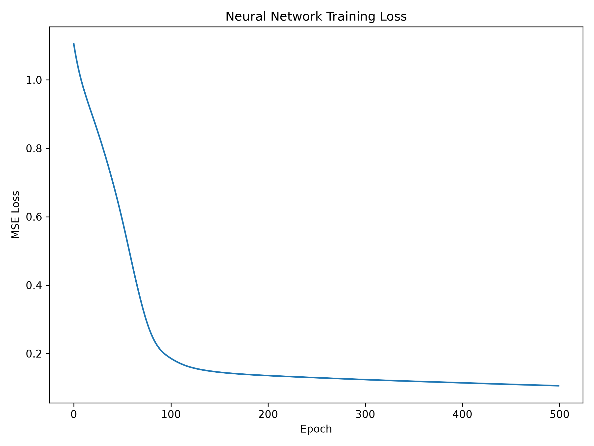

**신경망 — 실제값과 예측값 비교**

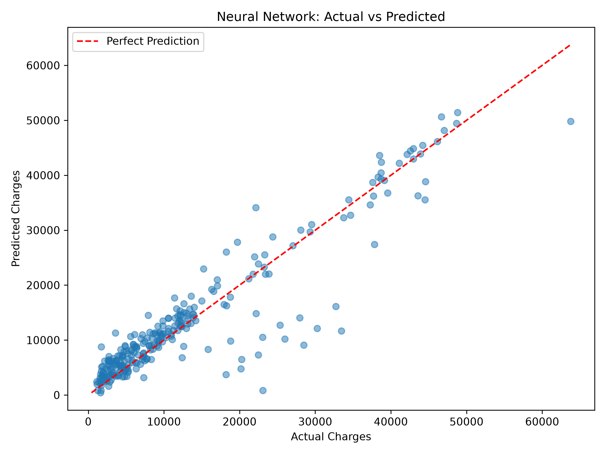

**베이지안 회귀 — 사후분포**

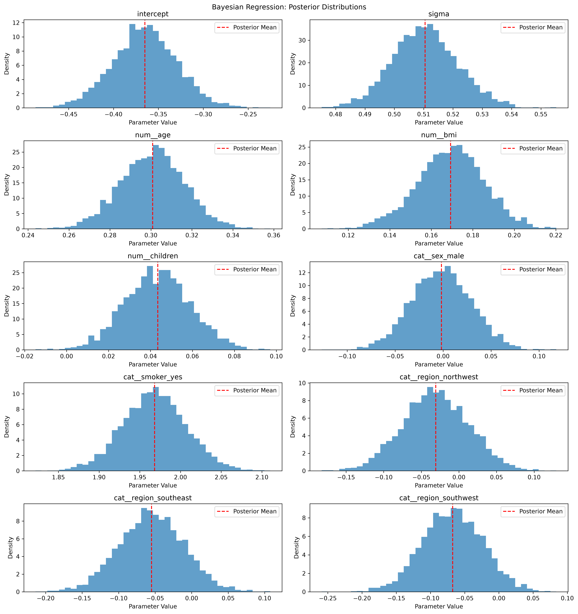

**베이지안 회귀 — 실제값과 예측값 비교**

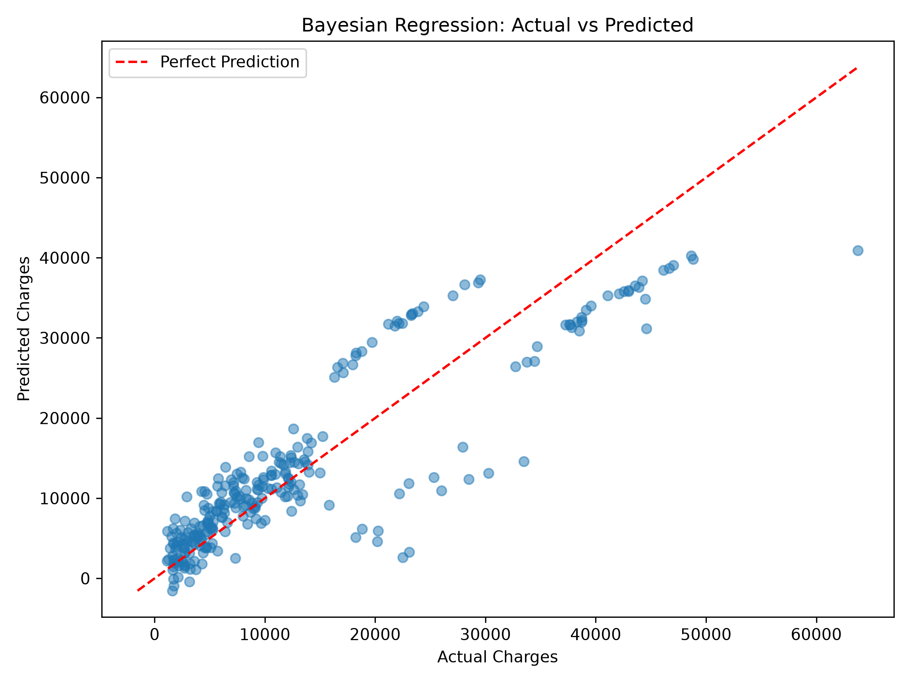

---

## 2. 분류 (Classification)

### 개요

CIFAR-10 이미지 데이터셋을 이용한 전통적인 머신러닝 분류 모델 구현 및 성능 비교

주성분 분석(PCA)을 이용하여 입력 데이터의 차원을 축소한 후 세 가지 분류 알고리즘의 성능 평가

### 데이터 전처리

- CIFAR-10 이미지 데이터의 특징 추출
- 주성분 분석(Principal Component Analysis, PCA) 적용
- 입력 특징을 200개 주성분으로 축소
- 전체 분산의 약 94.58% 유지

### 구현 내용

**PCA (`task4.py`)**
- 이미지 특징 데이터 전처리
- 차원 축소
- 설명 분산(Explained Variance) 분석

**의사결정나무 (Decision Tree, `task5.py`)**
- 트리 기반 분류 모델 구현
- 하이퍼파라미터 평가
- 혼동행렬(Confusion Matrix) 분석

**랜덤 포레스트 (Random Forest, `task6.py`)**
- 다수의 의사결정나무를 이용한 앙상블 학습
- 하이퍼파라미터 평가
- 분류 성능 분석

**서포트 벡터 머신 (Support Vector Machine, `task7.py`)**
- RBF 커널 적용
- 비선형 분류 모델 구현
- 하이퍼파라미터 평가
- 혼동행렬 분석

### 실험 결과

| 모델 | Test Accuracy |
|---|---:|
| Decision Tree | 31.10% |
| Random Forest | 46.55% |
| SVM (RBF) | **57.28%** |

RBF 커널을 적용한 SVM이 세 가지 모델 중 가장 높은 분류 정확도를 기록

### 시각화

#### Decision Tree

**하이퍼파라미터 평가**

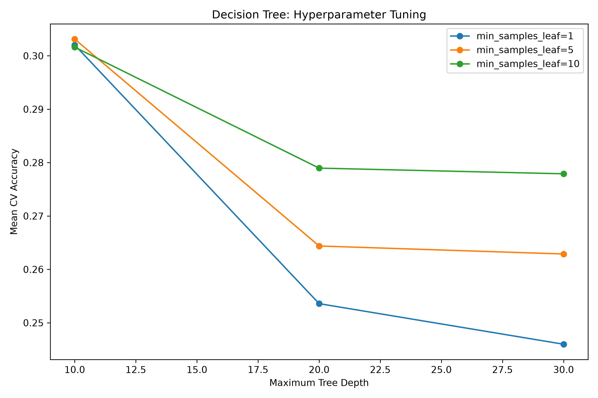

**혼동행렬**

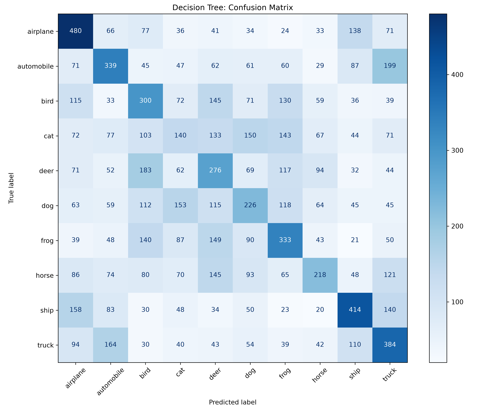

#### Random Forest

**하이퍼파라미터 평가**

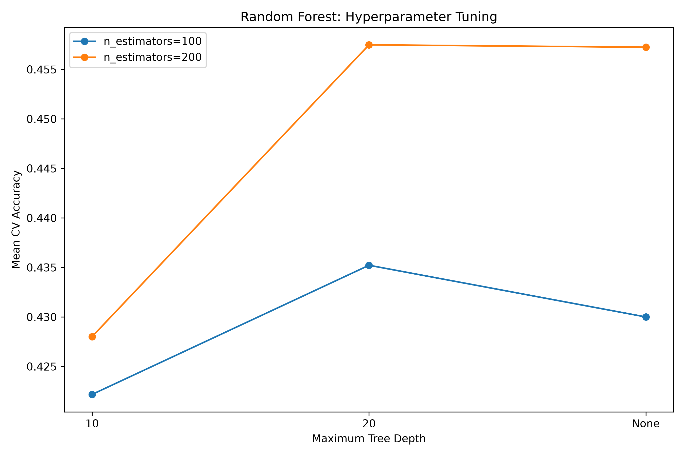

**혼동행렬**

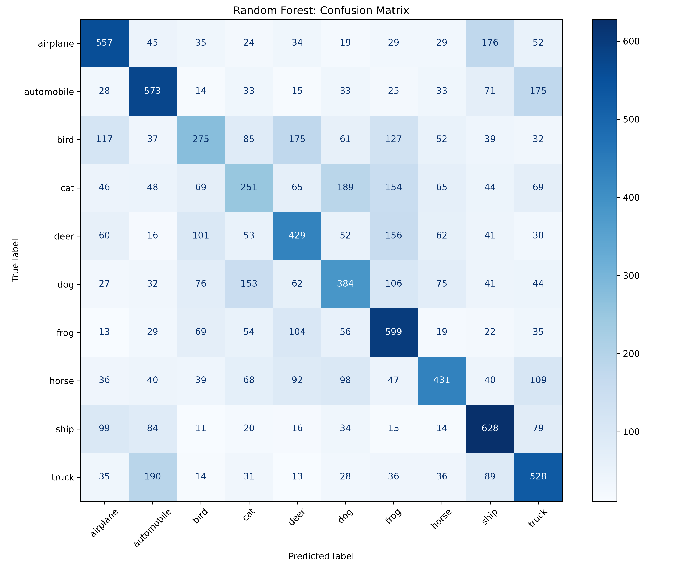

#### Support Vector Machine

**하이퍼파라미터 평가**

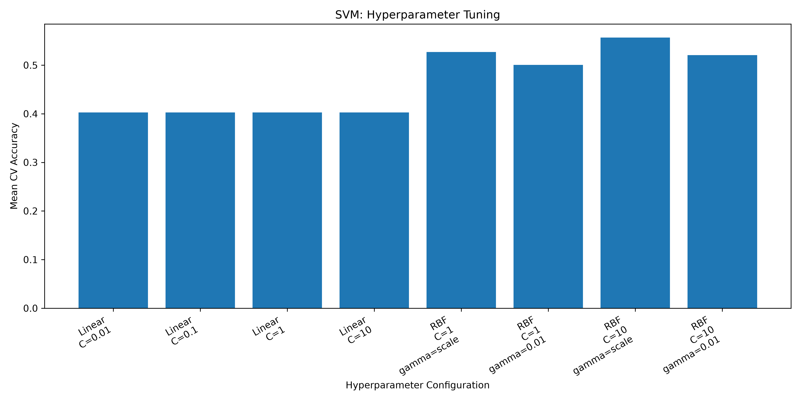

**혼동행렬**

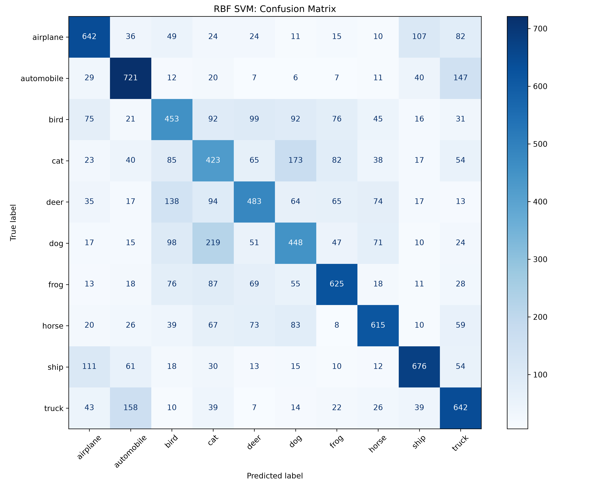

---

## 3. 군집화 (Clustering)

### 개요

MNIST 손글씨 숫자 데이터셋을 이용한 비지도학습 모델 구현 및 비교

K-Means와 Gaussian Mixture Model(GMM)을 적용하고 군집화 평가 지표를 이용하여 모델 성능 분석

### 데이터 전처리

- MNIST 손글씨 숫자 데이터셋 사용
- PCA 기반 차원 축소
- 50개 주성분 사용

### 구현 내용

**K-Means**
- 중심점(Centroid) 기반 군집화
- 군집 개수 선택
- 실루엣 점수(Silhouette Score) 평가
- 군집별 샘플 시각화

**가우시안 혼합 모델 (Gaussian Mixture Model, GMM)**
- 확률적 군집화
- 가우시안 혼합분포 추정
- 혼합 성분 개수 선택
- 군집별 샘플 시각화

### 실험 설정

| 파라미터 | 설정 |
|---|---|
| PCA Components | 50 |
| K-Means Clusters | 8 |
| K-Means Initialisations | 10 |
| GMM Components | 12 |
| GMM Covariance Type | Diagonal |

### 실험 결과

| 평가 지표 | K-Means | GMM |
|---|---:|---:|
| Silhouette Score | **0.0995** | 0.0372 |
| Adjusted Rand Index | **0.3890** | 0.2946 |

선택한 실험 설정에서 K-Means가 GMM보다 높은 Silhouette Score와 Adjusted Rand Index를 기록

### 시각화

**MNIST 데이터셋 샘플**

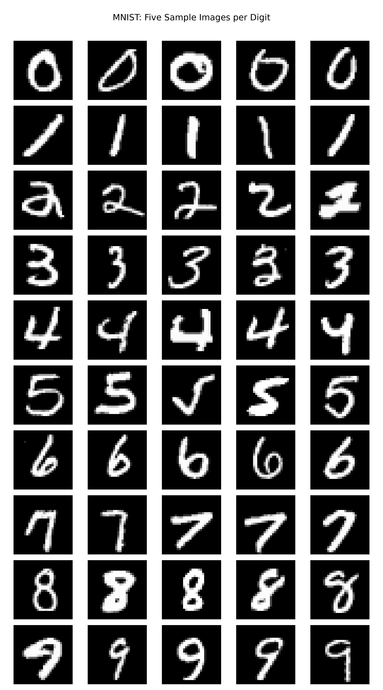

**K-Means — 군집별 샘플**

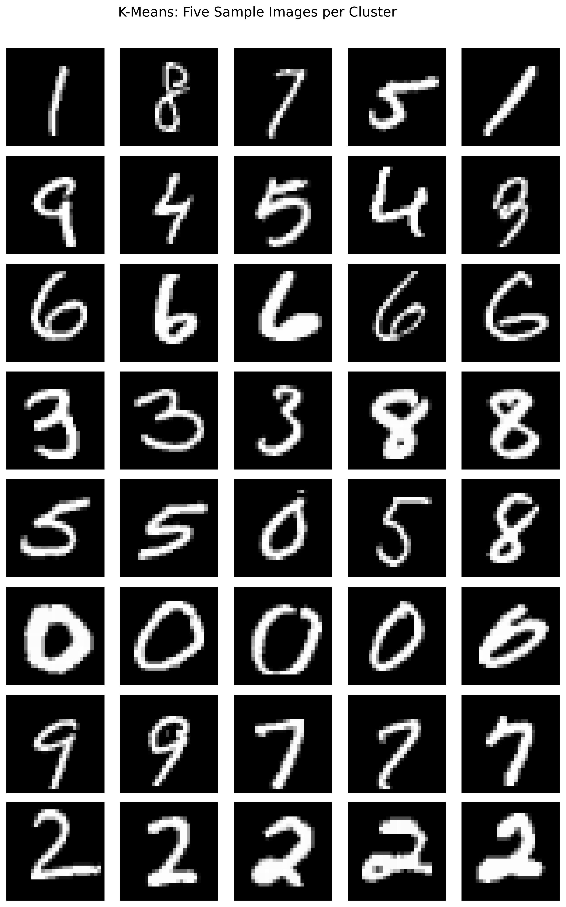

**GMM — 군집별 샘플**

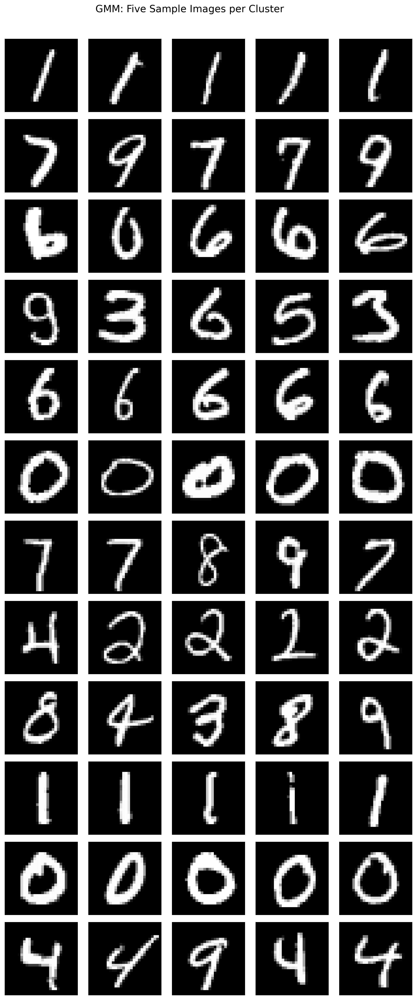

**군집화 모델 성능 비교**

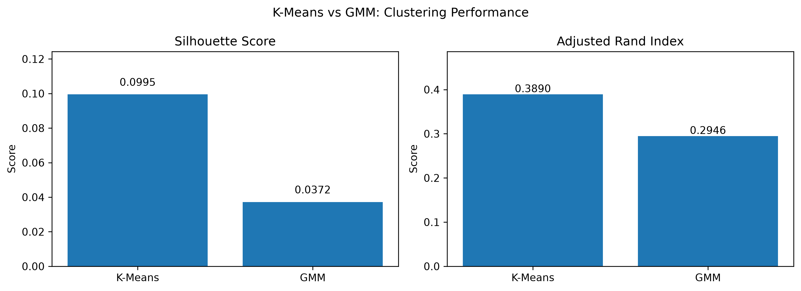

---

## 4. 순차 데이터 분석 (Sequential Data Analysis)

### 개요

베이지안 회귀와 은닉 마르코프 모델(Hidden Markov Model, HMM)을 이용한 시계열 데이터 분석

잉글랜드 및 웨일스의 월별 사망자 수와 기온 데이터를 활용하여 시간적 추세, 계절성, 기온의 영향 및 확률적 상태 전이 분석

### 4.1 베이지안 시계열 분석 (Bayesian Time-Series Analysis)

**구현 내용**
- PyMC 기반 베이지안 회귀 모델 구현
- 선형 시간 추세(Linear Trend) 반영
- 월별 계절 효과(Monthly Seasonal Effects) 반영
- 기온 효과(Temperature Effects) 반영
- MCMC를 이용한 사후분포 추정
- 사후예측분포(Posterior Predictive Distribution) 분석

**MCMC 수렴 진단**

기존 베이지안 모델의 최대 R-hat 값은 약 **1.0032**로, 일반적으로 사용되는 1.01 기준을 충족

### 4.2 학습 기간 비교 (Training Period Comparison)

서로 다른 학습 기간을 이용한 베이지안 모델의 파라미터 추정 결과 비교

- 2020년 이전 데이터 기반 학습
- 2010년 이전 데이터 기반 학습

| 파라미터 | Pre-2020 | Pre-2010 |
|---|---:|---:|
| Intercept | 44,500 | 45,300 |
| Temperature Coefficient | -415 | -406 |
| Linear Trend | 22.9 | 12.8 |
| Sigma | 2,658 | 2,570 |

학습 기간을 2010년 이전으로 제한했을 때 선형 추세 추정값이 감소했으며, 일부 파라미터의 사후분포에서 불확실성이 증가하는 경향 확인

### 4.3 변수 제거 실험 (Feature Ablation Study)

계절성과 기온 변수가 사망자 수 예측에 미치는 영향을 분석하기 위해 세 가지 베이지안 모델 비교

| 모델 | 월별 계절 효과 | 기온 | 선형 추세 |
|---|---|---|---|
| Original | 포함 | 포함 | 포함 |
| No Monthly Effects | 제거 | 포함 | 포함 |
| Trend Only | 제거 | 제거 | 포함 |

**실험 결과**

| 모델 | Posterior Mean of Sigma |
|---|---:|
| Original | 2,658 |
| No Monthly Effects | 3,365 |
| Trend Only | 4,730 |

월별 계절 효과를 제거하면 잔차 변동성이 증가하며, 기온 변수까지 제거할 경우 잔차 변동성이 추가로 증가

이를 통해 계절성과 기온 정보가 월별 사망자 수의 변동을 설명하는 데 기여함을 확인

### 4.4 은닉 마르코프 모델 (Hidden Markov Models)

사망자 수 데이터를 범주화하고 지도학습 및 비지도학습 방식의 HMM 두 가지 구현

**지도학습 HMM (Supervised HMM, `hmms.py`)**
- 기온 범주를 은닉 상태(Hidden States)로 사용
- 사망자 수 범주를 관측값(Observations)으로 사용
- 초기 상태 확률(Initial Probabilities) 추정
- 상태 전이 확률(Transition Probabilities) 직접 계산
- 관측 확률(Emission Probabilities) 직접 계산

**비지도학습 HMM (Unsupervised HMM, `hmms.py`)**
- 사망자 수 관측값만을 이용한 모델 학습
- Baum-Welch 알고리즘 기반 은닉 상태 학습
- `hmmlearn` 라이브러리 사용
- EM 알고리즘 수렴 확인

사망자 수는 다음 세 가지 범주로 구분

- Low: 낮은 사망자 수
- Medium: 중간 사망자 수
- High: 높은 사망자 수

### HMM 실험 결과

실제 사망자 수 범주별 분포와 두 HMM에서 생성한 관측값의 분포 비교

| 범주 | Actual | Supervised HMM | Unsupervised HMM |
|---|---:|---:|---:|
| Low | 33.50% | 35.42% | 32.82% |
| Medium | 32.99% | 32.15% | 32.58% |
| High | 33.50% | 32.43% | 34.60% |

두 HMM 모두 실제 데이터와 유사한 사망자 수 범주별 분포 생성

비지도학습 HMM이 이번 샘플링 실험에서 실제 범주별 비율과 조금 더 가까운 결과를 보였으나, 범주별 분포의 유사성만으로 시간적 패턴의 재현 성능까지 판단할 수는 없음

### 시각화

**실제 데이터와 HMM 생성 데이터의 사망자 수 분포 비교**

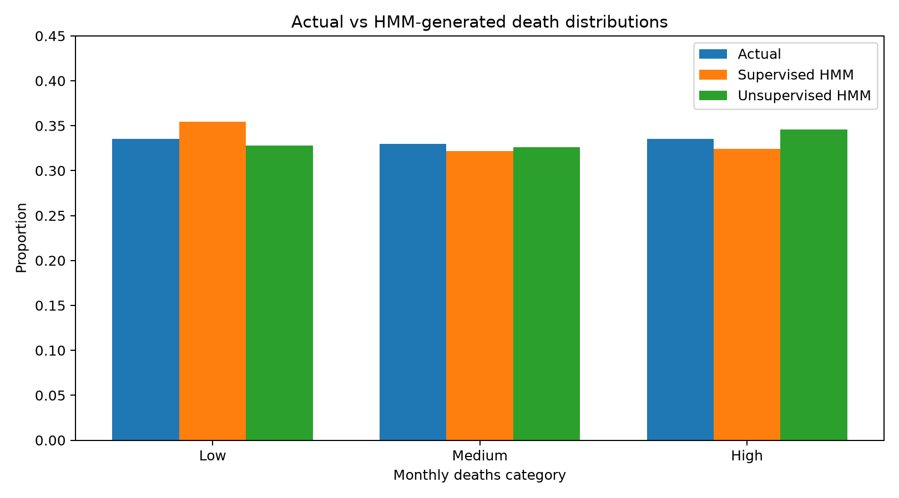

---

## 프로젝트 구조 (Project Structure)

```text
ml-models-and-evaluation/
├── regression/
│   ├── task1.py
│   ├── task2.py
│   ├── task3.py
│   ├── regression_insurance.csv
│   └── figures/
│       ├── linear_regression_scatter.png
│       ├── neural_network_loss.png
│       ├── neural_network_scatter.png
│       ├── bayesian_posterior.png
│       └── bayesian_regression_scatter.png
│
├── classification/
│   ├── task4.py
│   ├── task5.py
│   ├── task6.py
│   ├── task7.py
│   └── figures/
│       ├── decision_tree_hyperparameters.png
│       ├── decision_tree_confusion_matrix.png
│       ├── random_forest_hyperparameters.png
│       ├── random_forest_confusion_matrix.png
│       ├── svm_hyperparameters.png
│       └── svm_confusion_matrix.png
│
├── clustering/
│   ├── clustering.ipynb
│   └── figures/
│       ├── mnist_samples.png
│       ├── kmeans_cluster_samples.png
│       ├── gmm_cluster_samples.png
│       └── clustering_model_comparison.png
│
├── sequential/
│   ├── excess_deaths.ipynb
│   ├── excess_deaths_2010.ipynb
│   ├── excess_deaths_ablation.ipynb
│   ├── hmms.py
│   └── figures/
│       ├── hmm_death_distributions.png
│       └── hmm_death_distributions.csv
│
├── .gitignore
├── LICENSE
├── README.md
└── README.ko.md
```

데이터셋 디렉터리 및 중복 Notebook 파일은 가독성을 위해 생략

---

## 주요 결과 (Key Findings)

- **회귀:** 신경망 모델이 세 가지 회귀 모델 중 가장 낮은 예측 오차 기록
- **분류:** PCA로 차원을 축소한 CIFAR-10 데이터에서 RBF SVM이 가장 높은 분류 정확도 기록
- **군집화:** 선택한 실험 설정에서 K-Means가 GMM보다 높은 군집화 평가 점수 기록
- **베이지안 분석:** 계절성과 기온 변수가 월별 사망자 수의 변동을 설명하는 데 기여
- **은닉 마르코프 모델:** 지도학습 및 비지도학습 HMM 모두 실제 데이터와 유사한 사망자 수 범주별 분포 생성

---

## 참고 자료 (References)

- [Scikit-learn](https://scikit-learn.org/)
- [PyTorch](https://pytorch.org/)
- [PyMC](https://www.pymc.io/)
- [hmmlearn](https://hmmlearn.readthedocs.io/)
- [CIFAR-10](https://www.cs.toronto.edu/~kriz/cifar.html)
- [MNIST](https://yann.lecun.com/exdb/mnist/)
