# Machine Learning Models and Evaluation

A collection of machine learning experiments exploring **regression, classification, clustering, and sequential data analysis** using classical machine learning, neural networks, and probabilistic models.

The project focuses on model implementation, performance evaluation, hyperparameter selection, and visualisation of experimental results.

---

## Tech Stack

| Category | Technologies |
|---|---|
| Language | Python |
| Machine Learning | Scikit-learn, PyTorch |
| Bayesian Inference | PyMC, ArviZ |
| Sequential Modelling | hmmlearn |
| Data Processing | NumPy, Pandas |
| Visualisation | Matplotlib, Seaborn |
| Development | VS Code, Jupyter Notebook, Git |

---

## Project Overview

| Part | Task | Models | Dataset |
|---|---|---|---|
| 1 | Regression | Linear Regression, Neural Network, Bayesian Regression | Insurance Charges |
| 2 | Classification | Decision Tree, Random Forest, SVM | CIFAR-10 |
| 3 | Clustering | K-Means, Gaussian Mixture Model | MNIST |
| 4 | Sequential Analysis | Bayesian Time Series, Hidden Markov Models | England & Wales Mortality Data |

---

## 1. Regression

### Overview

Predict individual medical insurance charges using demographic and lifestyle features.

Three regression approaches were implemented and compared using Root Mean Squared Error (RMSE).

### Implementation

**Linear Regression (`task1.py`)**
- Feature standardisation using `StandardScaler`
- Categorical encoding using `OneHotEncoder`
- Linear regression using Scikit-learn
- Regression coefficient analysis
- Actual vs. predicted value visualisation

**Neural Network (`task2.py`)**
- Feedforward neural network using PyTorch
- Nonlinear regression modelling
- Model training and evaluation
- Prediction error analysis

**Bayesian Regression (`task3.py`)**
- Probabilistic regression using PyMC
- Posterior inference for model parameters
- Uncertainty estimation
- Prediction and evaluation

### Results

| Model | Test RMSE |
|---|---:|
| Linear Regression | 5,796.285 |
| Neural Network | **4,649.163** |
| Bayesian Regression | 5,795.658 |

The neural network achieved the lowest RMSE, demonstrating improved predictive performance over the linear and Bayesian regression models.

### Visualisation

**Linear Regression — Actual vs. Predicted**


**Neural Network — Training Loss**

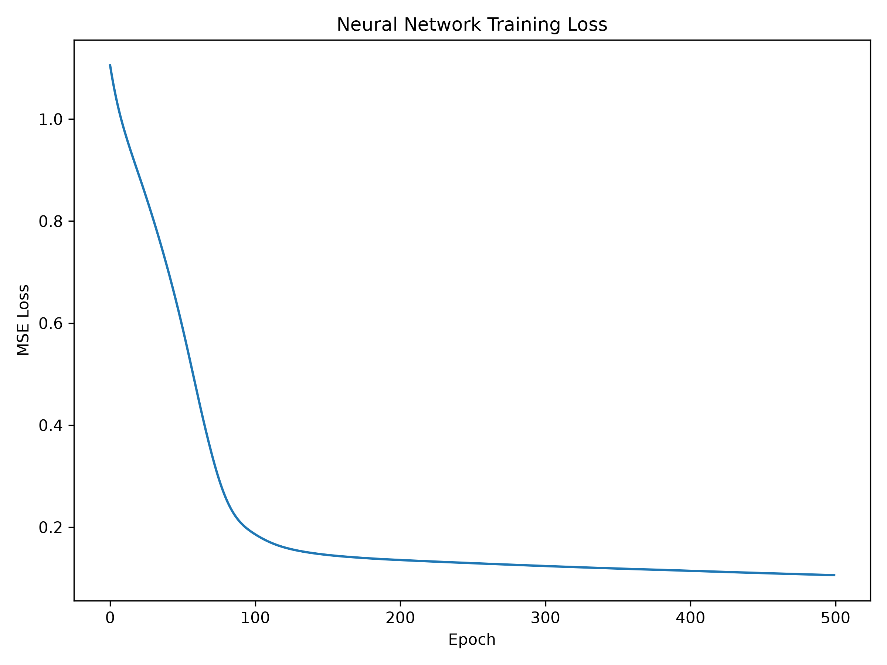

**Neural Network — Actual vs. Predicted**

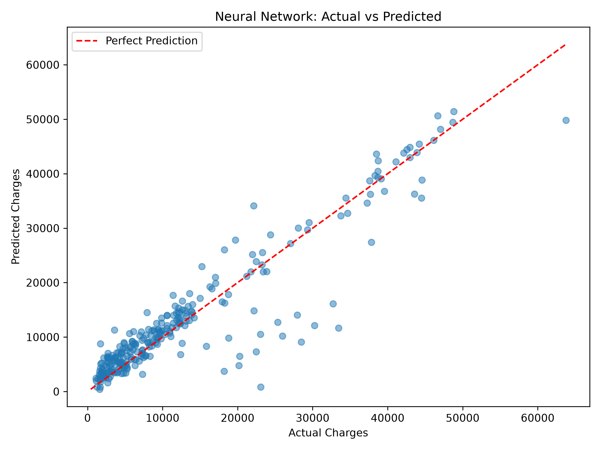

**Bayesian Regression — Posterior Distribution**

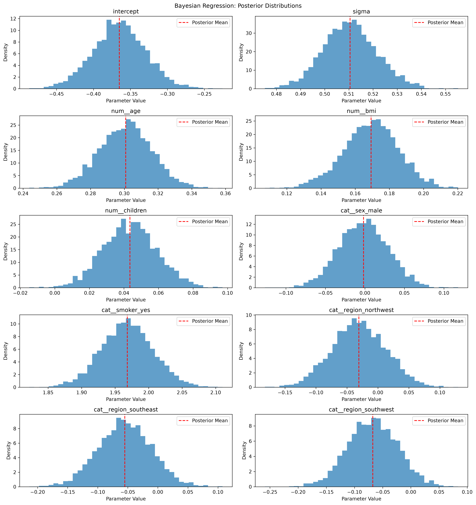

**Bayesian Regression — Actual vs. Predicted**

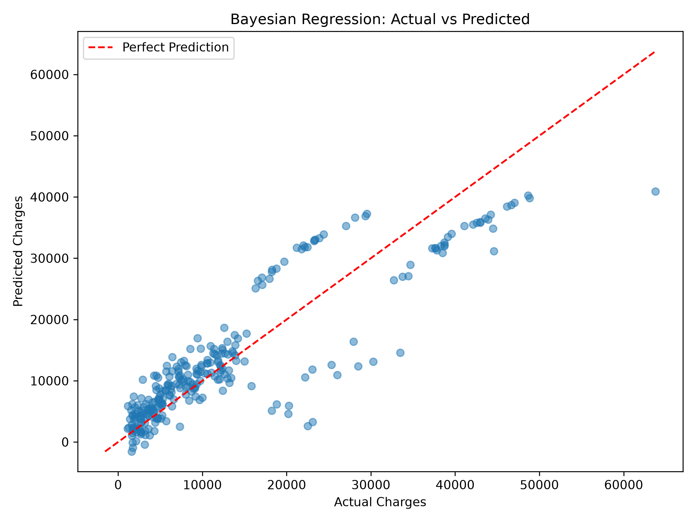

---

## 2. Classification

### Overview

Classify CIFAR-10 images using traditional machine learning algorithms with PCA-based dimensionality reduction.

### Preprocessing

- CIFAR-10 image feature extraction
- Principal Component Analysis (PCA)
- Dimensionality reduction to 200 components
- Approximately 94.58% explained variance

### Implementation

**PCA (`task4.py`)**
- Image feature preprocessing
- Dimensionality reduction
- Explained variance analysis

**Decision Tree (`task5.py`)**
- Tree-based classification
- Hyperparameter evaluation
- Confusion matrix analysis

**Random Forest (`task6.py`)**
- Ensemble learning using multiple decision trees
- Hyperparameter evaluation
- Classification performance analysis

**Support Vector Machine (`task7.py`)**
- RBF kernel
- Nonlinear classification
- Hyperparameter evaluation
- Confusion matrix analysis

### Results

| Model | Test Accuracy |
|---|---:|
| Decision Tree | 31.10% |
| Random Forest | 46.55% |
| SVM (RBF) | **57.28%** |

The RBF SVM achieved the highest classification accuracy among the evaluated models.

### Visualisation

#### Decision Tree

**Hyperparameter Evaluation**

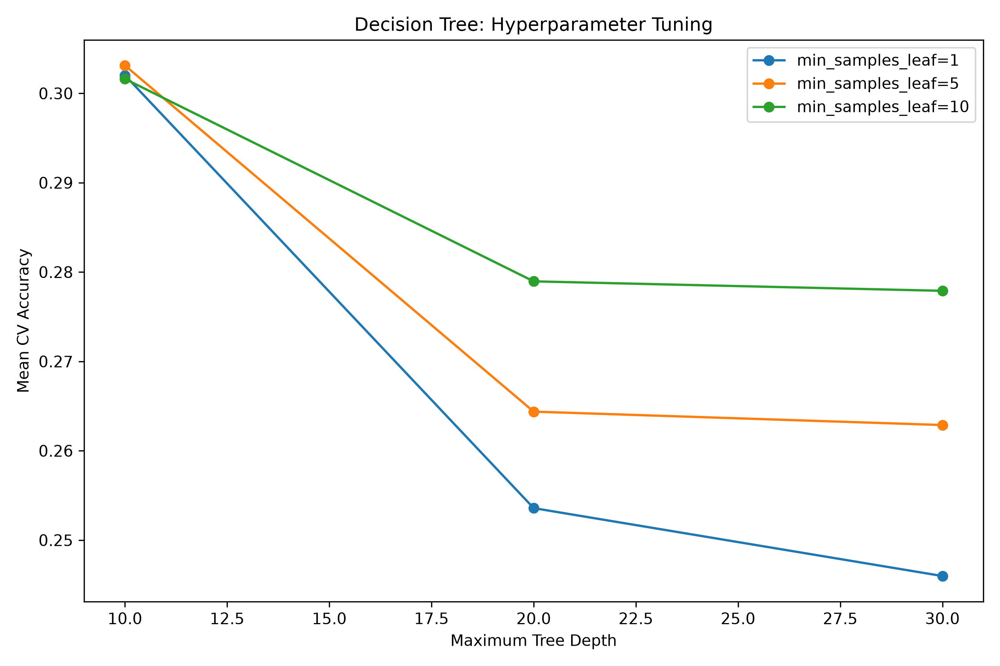

**Confusion Matrix**

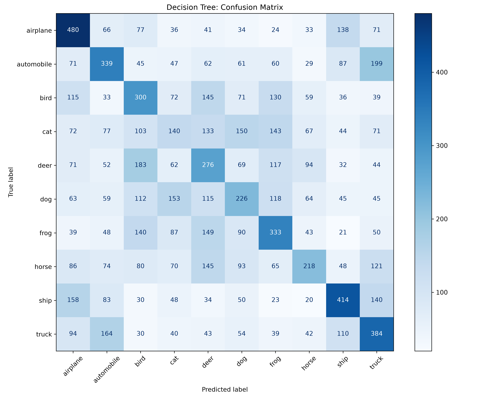

#### Random Forest

**Hyperparameter Evaluation**

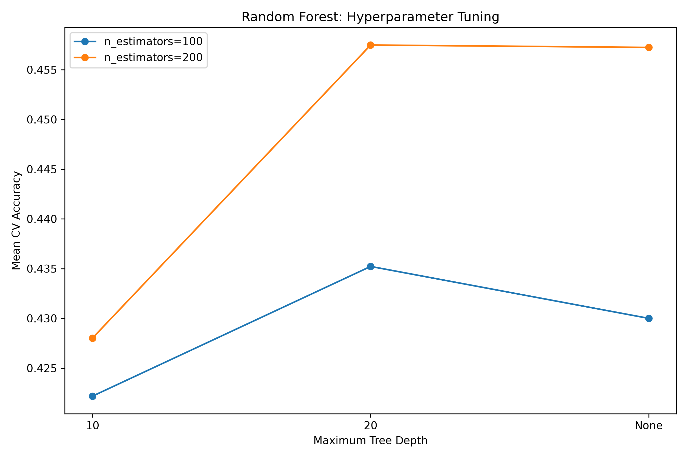

**Confusion Matrix**

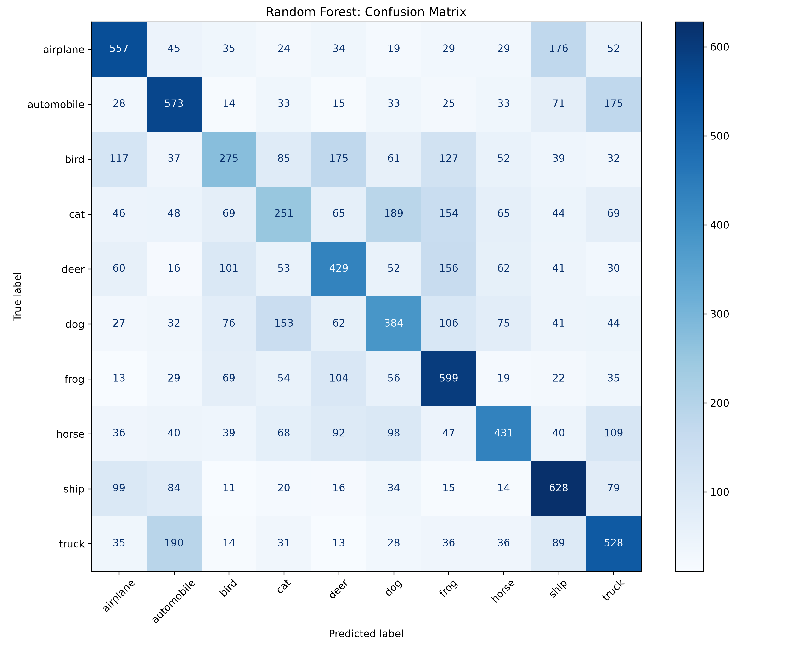

#### Support Vector Machine

**Hyperparameter Evaluation**

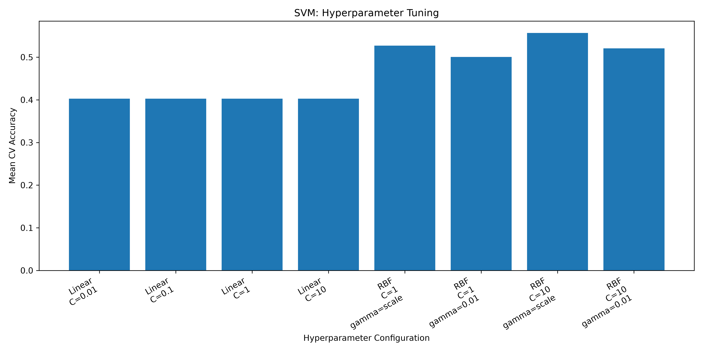

**Confusion Matrix**

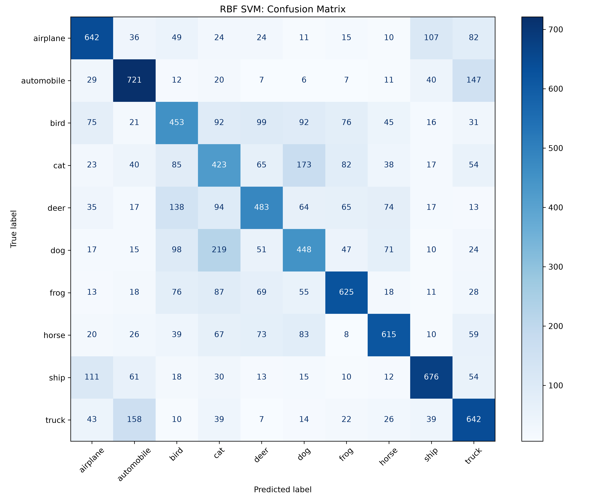

---

## 3. Clustering

### Overview

Explore unsupervised learning using the MNIST handwritten digit dataset.

K-Means and Gaussian Mixture Models (GMM) were implemented and evaluated using internal and external clustering metrics.

### Preprocessing

- MNIST handwritten digit dataset
- PCA dimensionality reduction
- 50 principal components

### Implementation

**K-Means**
- Centroid-based clustering
- Cluster count selection
- Silhouette score evaluation

**Gaussian Mixture Model (GMM)**
- Probabilistic clustering
- Gaussian mixture estimation
- Comparison with K-Means

### Experimental Configuration

| Parameter | Configuration |
|---|---|
| PCA Components | 50 |
| K-Means Clusters | 8 |
| K-Means Initialisations | 10 |
| GMM Components | 12 |
| GMM Covariance Type | Diagonal |

### Results

| Metric | K-Means | GMM |
|---|---:|---:|
| Silhouette Score | **0.0995** | 0.0372 |
| Adjusted Rand Index | **0.3890** | 0.2946 |

K-Means achieved higher Silhouette and Adjusted Rand Index scores than GMM under the selected configurations.

### Visualisation

**MNIST Dataset Samples**

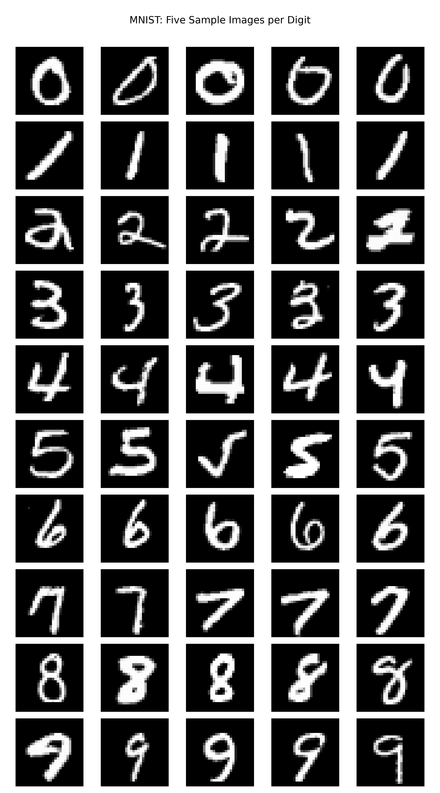

**K-Means — Cluster Samples**

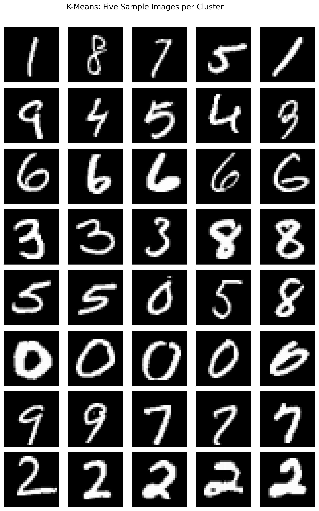

**GMM — Cluster Samples**

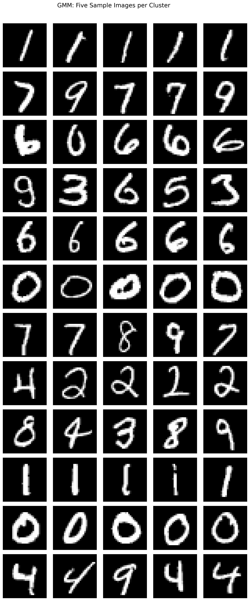

**Clustering Model Comparison**

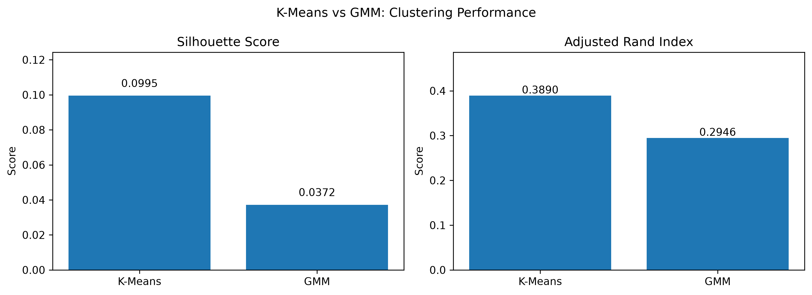

---

## 4. Sequential Data Analysis

### Overview

Analyse time-dependent mortality data using Bayesian regression and Hidden Markov Models (HMMs).

The experiments use monthly mortality and temperature observations from England and Wales.

### 4.1 Bayesian Time-Series Analysis

**Implementation**
- Bayesian regression using PyMC
- Linear time trend
- Monthly seasonal effects
- Temperature effects
- Posterior inference using MCMC
- Posterior predictive analysis

**Convergence Diagnostics**

The original Bayesian model achieved a maximum R-hat of approximately **1.0032**, indicating satisfactory MCMC convergence.

### 4.2 Training Period Comparison

Compare Bayesian models trained using different historical periods.

| Parameter | Pre-2020 | Pre-2010 |
|---|---:|---:|
| Intercept | 44,500 | 45,300 |
| Temperature Coefficient | -415 | -406 |
| Linear Trend | 22.9 | 12.8 |
| Sigma | 2,658 | 2,570 |

The shorter training period produced a lower estimated linear trend and increased uncertainty in some posterior parameter estimates.

### 4.3 Feature Ablation Study

Evaluate the contribution of seasonal and temperature features by comparing three Bayesian models.

| Model | Monthly Effects | Temperature | Linear Trend |
|---|---|---|---|
| Original | Yes | Yes | Yes |
| No Monthly Effects | No | Yes | Yes |
| Trend Only | No | No | Yes |

**Results**

| Model | Posterior Mean of Sigma |
|---|---:|
| Original | 2,658 |
| No Monthly Effects | 3,365 |
| Trend Only | 4,730 |

Removing seasonal effects increased residual variability, while removing both seasonal and temperature effects produced a further increase.

These results indicate that seasonal patterns and temperature contribute to explaining monthly mortality variation.

### 4.4 Hidden Markov Models

Two HMM approaches were implemented to model discretised mortality observations.

**Supervised HMM (`hmms.py`)**
- Temperature categories used as hidden states
- Mortality categories used as observations
- Initial probabilities estimated from observed states
- Transition and emission probabilities estimated directly

**Unsupervised HMM (`hmms.py`)**
- Mortality observations used for training
- Hidden states learned through the Baum-Welch algorithm
- Implemented using `hmmlearn`
- EM convergence verified

### HMM Results

| Category | Actual | Supervised HMM | Unsupervised HMM |
|---|---:|---:|---:|
| Low | 33.50% | 35.42% | 32.82% |
| Medium | 32.99% | 32.15% | 32.58% |
| High | 33.50% | 32.43% | 34.60% |

Both HMMs generated mortality-category distributions similar to the observed data.

The unsupervised model produced slightly smaller marginal distribution errors in this experiment.

### Visualisation

**Actual vs. HMM-Generated Mortality Distributions**

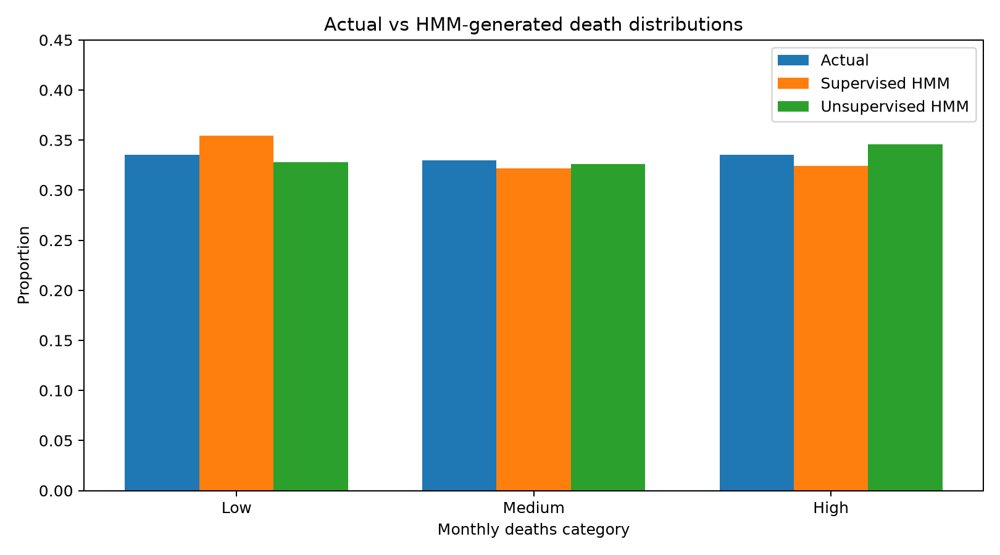

---

## Project Structure

```text
ml-models-and-evaluation/
├── regression/
│   ├── task1.py
│   ├── task2.py
│   ├── task3.py
│   ├── regression_insurance.csv
│   └── figures/
│       ├── linear_regression_scatter.png
│       ├── neural_network_loss.png
│       ├── neural_network_scatter.png
│       ├── bayesian_posterior.png
│       └── bayesian_regression_scatter.png
│
├── classification/
│   ├── task4.py
│   ├── task5.py
│   ├── task6.py
│   ├── task7.py
│   └── figures/
│       ├── decision_tree_hyperparameters.png
│       ├── decision_tree_confusion_matrix.png
│       ├── random_forest_hyperparameters.png
│       ├── random_forest_confusion_matrix.png
│       ├── svm_hyperparameters.png
│       └── svm_confusion_matrix.png
│
├── clustering/
│   ├── clustering.ipynb
│   └── figures/
│       ├── mnist_samples.png
│       ├── kmeans_cluster_samples.png
│       ├── gmm_cluster_samples.png
│       └── clustering_model_comparison.png
│
├── sequential/
│   ├── excess_deaths.ipynb
│   ├── excess_deaths_2010.ipynb
│   ├── excess_deaths_ablation.ipynb
│   ├── hmms.py
│   └── figures/
│       ├── hmm_death_distributions.png
│       └── hmm_death_distributions.csv
│
├── .gitignore
├── LICENSE
└── README.md
```

Dataset directories and duplicate notebook copies are omitted for clarity.

---

## Key Findings

- **Regression:** The neural network achieved the lowest prediction error among the three regression approaches.
- **Classification:** RBF SVM outperformed Decision Tree and Random Forest on PCA-reduced CIFAR-10 features.
- **Clustering:** K-Means achieved higher clustering evaluation scores than GMM under the selected configurations.
- **Bayesian Analysis:** Seasonal and temperature effects contributed to explaining mortality variation.
- **Hidden Markov Models:** Both supervised and unsupervised HMMs reproduced the observed marginal mortality-category distribution reasonably well.

---

## References

- [Scikit-learn](https://scikit-learn.org/)
- [PyTorch](https://pytorch.org/)
- [PyMC](https://www.pymc.io/)
- [hmmlearn](https://hmmlearn.readthedocs.io/)
- [CIFAR-10](https://www.cs.toronto.edu/~kriz/cifar.html)
- [MNIST](https://yann.lecun.com/exdb/mnist/)
